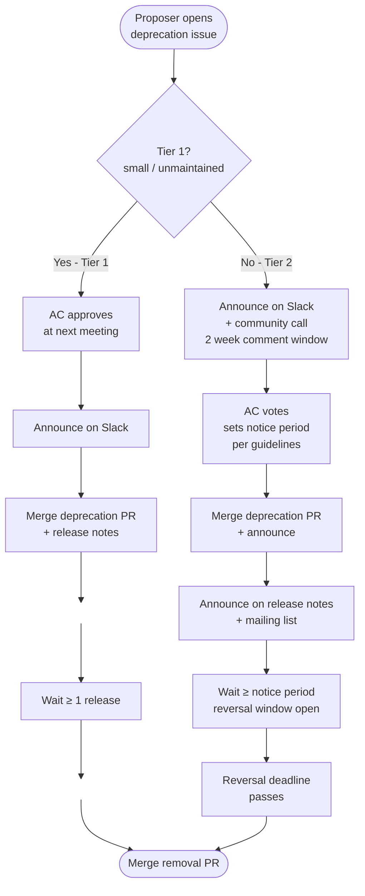

# Kata Containers Deprecation Process

This document describes the process for deprecating and removing features,
components, tools, or platform support from the Kata Containers project.

> **Status:** This is a first draft for community discussion. Specific
> notice periods, decision thresholds, and documentation locations are
> presented as options rather than final decisions.

## Why we deprecate

The Kata Containers project has grown to include many hypervisors, platforms,
tools, and features. Not all of them have active maintainers or CI coverage.
Keeping unmaintained code in the tree creates a real burden: security
vulnerabilities accumulate, build breakages go unnoticed, and review effort
is spent on code that few or no users rely on.

Deprecation is how we communicate intent clearly and give the community time
to adapt, object, or step up to maintain a feature before it is removed.

## Scope

This process applies to any intentional removal or end-of-support for:

- Features (e.g. virtio-9p, pmem/DAX support)
- Hypervisors (e.g. firecracker, remote)
- Platform architectures (e.g. ppc64le, risc-v)
- Tools (e.g. kata-monitor, trace-forwarder)
- Runtime variants (e.g. the Go runtime)
- Container runtime integrations (e.g. CRI-O)
- Rootfs base operating systems (e.g. alpine, centos)
- Test infrastructure components
- Configuration options within existing components

It does **not** currently apply to bug fixes or behavioural changes that
do not remove user-accessible functionality.

## Feature classification

The support status of every component is tracked in
[`docs/Maintenance.md`](Maintenance.md) *(not yet merged — see [#12490](https://github.com/kata-containers/kata-containers/pull/12490))*. The states relevant to this
process are:

| State | Meaning |
|---|---|
| **Not maintained** | No current maintainers. Open to new ones. Candidate for deprecation if no maintainer volunteers within a reasonable period. |
| **Deprecated** | Officially deprecated. Removal is planned. The deprecation notice includes the earliest release eligible for removal. |

Moving a component from any state to **Deprecated** requires following the
process below. Moving it from **Deprecated** to removed requires completing
the notice period and going through the removal step.

## Process tiers

Not all deprecations are equal. A two-tier model balances the needs of a
small unmaintained tool against those of a widely-used hypervisor. The AC
decides which tier applies when approving a deprecation. The notice period
defines the *earliest* a component may be removed — removal is not automatic
and requires an explicit PR. A deprecated component will remain in the tree
until that PR is merged.



### At a glance

| Stage | Tier 1 — Lightweight | Tier 2 — Formal |
|---|---|---|
| **Open issue** | Describe component, reason, migration path | As Tier 1, plus: known users/downstream consumers, runtime warning feasibility |
| **Community notification** | *(none before AC vote)* | Announce on Slack + community call; 2-week comment window before AC votes |
| **AC decision** | Approves/rejects at next meeting | Votes after 2-week window; sets explicit notice period |
| **Deprecation PR** | Update `Maintenance.md` + `deprecated.md` | As Tier 1, plus: target removal release + optional runtime warning |
| **Announce** | Release notes + Slack | Release notes + Slack + mailing list |
| **Notice period** | 1 release | Variable: 3–6+ releases per guidelines |
| **Reversal** | *(none)* | Comment on issue + community call; must be raised before period expires |
| **Removal PR** | Any release after N+1 | Any release after notice period expires |

### Tier 1 — Lightweight (small/unmaintained components)

Suitable for: tools with no CI coverage, rootfs variants with no active
maintainers, test-infrastructure items, or features superseded by a clear
replacement and known to have minimal active use.

Examples: `runk`, `containerd stability` tests, `alpine` rootfs.

**Minimum notice period: 1 release.**

The deprecation notice is published in the release notes of release N. The
component is eligible for removal from release N+1 onward.

Steps:

1. Proposer opens a GitHub Issue labelled `deprecation` describing
   the component, the reason, and any migration path.
2. The AC reviews at the next regular meeting and approves or rejects.
3. If approved, the deprecation issue is announced on `#kata-dev` Slack.
4. A PR is merged that updates `docs/Maintenance.md` to
   **Deprecated** and adds an entry to `docs/deprecated.md`
   (see [Documentation](#documentation)).
5. The deprecation is announced in the release notes of the next release.
6. The component may be removed in any subsequent release. A PR removes the
   code and moves the entry from `docs/deprecated.md` to
   `docs/removed-features.md`.

### Tier 2 — Formal (significant/widely-used components)

Suitable for: actively maintained hypervisors, platform architectures with
known users, runtime variants, or any component where removal has broad
impact.

Examples: the Go runtime, qemu on a new major version boundary, ppc64le.

**Minimum notice period: variable — see guidelines below.**

The AC sets the notice period explicitly when approving the deprecation.
Guidelines (open for community discussion):

| Component type | Suggested minimum notice |
|---|---|
| Major runtime variant (e.g. Go runtime) | 6 releases (~6 months), or aligned to a major version boundary |
| Hypervisor | 6 releases, or a major version boundary — whichever is longer |
| Platform architecture | 6 releases |
| Tool or rootfs variant with some usage | 3 releases |
| Configuration option or flag | 3 releases |

These are starting points. The AC may increase, or decrease a notice
period relative to the table above, and has final discretion.

> **Note:** If this deprecation is driven by an upstream dependency removing a
> feature, see [Upstream-forced removals](#upstream-forced-removals) before
> proceeding — a reduced notice period may apply.

Steps:

1. Proposer opens a GitHub Issue labelled `deprecation` with:
   - The component name and its current `Maintenance.md` classification
   - The reason for deprecation
   - Suggested migration path or replacement
   - **[Tier 2 only]** Any known users or downstream consumers
   - **[Tier 2 only]** Whether a runtime warning in the code is feasible (see [Runtime warnings](#optional-runtime-warnings))
2. **[Tier 2 only]** The proposer announces the issue on `#kata-dev` Slack and on the community call,
   giving the community at least **two weeks** to respond before the AC votes.
3. The AC votes at a regular meeting. Approval requires AC consensus.
   Community objections are considered but do not constitute a veto; the
   AC's decision is final.
4. **[Tier 2 only]** If approved, the AC records the agreed notice period (in releases) and
   the earliest release eligible for removal.
5. A PR is merged that:
   - Updates `docs/Maintenance.md` to **Deprecated**
   - Adds an entry to `docs/deprecated.md`
   - **[Tier 2 only]** Includes the target removal release in `docs/Maintenance.md`
   - **[Tier 2 only]** Optionally adds a runtime warning (see [Optional runtime warnings](#optional-runtime-warnings))
6. The deprecation is announced in the release notes of the next release and on Slack.
   **[Tier 2 only]** Also announced on the mailing list.
7. **[Tier 2 only]** During the notice period, anyone who objects may comment on the
   deprecation issue and bring this to the community call with justification. Valid grounds
   include: a new maintainer volunteering, a concrete plan to restore CI
   coverage, or evidence of significant active use not previously known. The
   AC evaluates the reversal and may cancel the deprecation. Reversal requests
   must be raised before the notice period expires; requests raised after are
   not guaranteed consideration.
8. Once the notice period has elapsed, a PR removes the code and moves the entry
   to `docs/removed-features.md`.

## Upstream-forced removals

Occasionally an upstream dependency removes a feature without adequate
notice — for example, a hypervisor upstream dropping support for a guest
feature. This creates a special case: Kata cannot restore the feature
unilaterally, and delaying the dependency bump may introduce security
vulnerabilities.

**Recommended approach:**

1. The proposer opens a `deprecation` issue as usual, clearly
   marking it as upstream-forced and linking the upstream change.
2. If the upstream project had its own deprecation notice that Kata users
   could reasonably have seen, the AC applies the normal tier process.
3. If the removal was abrupt (no prior upstream warning), the AC may approve
   an **expedited track**:
   - Minimum notice: **1 release** regardless of component tier.
   - The justification (upstream breakage, security risk of delaying) must
     be stated explicitly in the deprecation notice.
4. The announcement must clearly explain that this is upstream-forced, so
   users understand it is not a Kata-originated decision.

> **Open question for community discussion:** Should Kata maintain a policy
> of monitoring release notes for key upstream dependencies and initiating
> deprecation in advance, rather than reacting after the fact?

## Optional runtime warnings

Where technically feasible, components should emit a log-level warning when
a deprecated feature is active at startup or invocation. This gives users
an in-process signal without requiring them to read release notes.

This is **optional** — it is not always practical (e.g. removing an entire
hypervisor binary). When it is done, the warning should:

- Be emitted at `WARN` level
- State the component name, the release it was deprecated in, and the
  earliest release it may be removed from
- Reference the migration path or a documentation link

Example log message:
```
WARN: The kata-monitor tool is deprecated as of release 4.X.0 and will be
removed no earlier than release 4.Y.0. See docs/deprecated.md for details.
```

## Documentation

### `docs/Maintenance.md`

The living source of truth for component support status. When a component
is deprecated, its row is updated with:
- State: **Deprecated**
- A note field containing the release deprecated in and the earliest
  removal release.

### `docs/deprecated.md` *(new file)*

A permanent list of all currently deprecated components. Each entry should
include:

- Component name
- Release deprecated in (e.g. `3.25.0`)
- Earliest release eligible for removal
- Reason
- Migration path or replacement (if any)
- Link to the originating deprecation issue

**Alternative:** If the community prefers a single integrated document,
this information can live directly in `docs/Maintenance.md` with the
"Deprecated" rows expanded to include those fields. Either approach is
acceptable; consistency matters more than the choice.

### `docs/removed-features.md` *(new file)*

A permanent historical record of features that have been removed. Each
entry should include:

- Component name
- Release removed in
- Release deprecated in
- Brief reason
- Link to the removal PR

This file is append-only. Entries are never deleted.

## Open questions for community discussion

The following are explicitly unresolved and intended for community input:

1. **Tier boundaries**: The table of notice periods above is a starting
   point. Are the suggested minimums right, or should some categories be
   longer or shorter?

2. **"Not maintained" to "Deprecated" pipeline**: Should components that
   have been in the "Not maintained" state for more than N releases be
   automatically proposed for deprecation? This could reduce the
   accumulation of zombie code without requiring individual proposals.

3. **Upstream monitoring**: Should there be a defined process for tracking
   deprecation notices in upstream dependencies (hypervisors, kernels, etc.)
   so that Kata can act proactively rather than reactively?

4. **Grandfathering existing "Deprecated" entries**: `docs/Maintenance.md`
   already lists several components as Deprecated. This process does not
   retroactively apply to them, but they should eventually be either removed
   or re-evaluated. How should those be handled?
