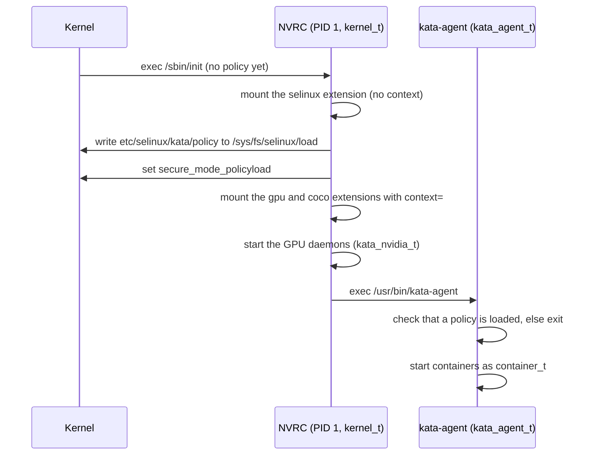

# Guest SELinux Extension

## Summary

The NVIDIA runtime-rs configurations can enforce SELinux inside the guest. The
policy ships as a [composable guest extension](composable-vm-images.md) named
`selinux`: an EROFS + dm-verity image mounted at `/run/kata-extensions/selinux`.
NVRC, the NVIDIA guest init, loads the policy before it mounts any other
extension and before it starts kata-agent. kata-agent refuses to start when the
kernel command line asks for SELinux (`selinux=1`) but no policy is loaded.

The feature is off by default. It is scoped to runtime-rs and to the NVIDIA
guest (NVRC as PID 1). The Go runtime and the systemd-based guests are not
covered.

## Motivation

Without a guest policy, every process in the guest runs unconfined: the agent,
the attestation and image-pull components, the GPU daemons, and the container
workloads. A container that escapes its namespaces reaches all of them.
Confining the workload with the same `container_t` domain the host uses, and
giving the Kata and NVIDIA components their own domains, bounds that.

Shipping the policy as an extension keeps it out of the base image. The policy
has its own measured root hash, and can be rebuilt without rebuilding the base
image.

## Design

### Boot flow



NVRC loads the policy for two reasons:

- NVRC mounts the extensions, and `context=` mount options are rejected until a
  policy is loaded. The policy therefore has to be in place before the gpu and
  coco extensions are mounted, which happens before kata-agent runs.
- The agent's domain comes from the transition `kernel_t` →
  `kata_agent_t` on exec of `kata_agent_exec_t`. The agent could not move itself
  into its domain after the fact.

NVRC fails closed. When `selinux=1` is set and the `selinux` extension is
missing, or the guest kernel has SELinux disabled, NVRC panics and the VM powers
off.

After the load, NVRC sets the `secure_mode_policyload` boolean. From then on
the policy denies further policy loads, `setenforce` and `setbool` to every
domain, NVRC included. A policy without that boolean is refused at build time,
and NVRC panics if it ever meets one: a policy that can be replaced at runtime
does not protect anything.

### Runtime configuration

The four NVIDIA runtime-rs QEMU configurations list the extension and expose
two knobs:

```toml title="configuration-qemu-nvidia-gpu-runtime-rs.toml"
[hypervisor.qemu]
disable_guest_selinux = true # (1)!

[runtime]
guest_selinux_label = "" # (2)!

[[hypervisor.qemu.guest_extension_images]]
name = "selinux"
path = "/opt/kata/share/kata-containers/kata-containers-selinux-extension.img"
verity_params = "root_hash=...,salt=...,data_blocks=...,data_block_size=4096,hash_block_size=4096"
```

1. When `false`, runtime-rs emits `selinux=1`. The NVIDIA `kernel_params`
   carry `enforcing=1`, as the guest kernel otherwise boots permissive;
   appending `enforcing=0` to them boots permissive for bring-up.
2. The label given to container processes in the guest. When empty, the host
   label's type is replaced with `container_t` and its MCS level is kept. Hosts
   without SELinux pass no label, and `system_u:system_r:container_t:s0` is
   used instead, so the workload never keeps the agent's domain.

!!! note
    The extension is attached even when guest SELinux is disabled. With
    `selinux=0` the guest kernel exposes no selinuxfs, and NVRC mounts the
    extension without loading anything.

### Domains

| Domain | Runs | Enforced |
| --- | --- | --- |
| `kernel_t` | NVRC, the syslog poller | Unconfined, as in the base policy |
| `kata_agent_t` | kata-agent, from the base image | Yes |
| `kata_nvidia_t` | Binaries run from the gpu extension | Permissive |
| `kata_coco_t` | Binaries the agent runs from the coco extension (attestation-agent, CDH, image-rs) | Permissive |
| `kata_mkfs_t` | The unpacked `dd` and `mke2fs` used for encrypted scratch volumes | Yes |
| `container_t` | Container processes | Yes |

`kata_agent_t` is a member of `container_runtime_domain`. That attribute
carries the rules container-selinux writes for runc: namespace and mount
setup, and the transition into `container_t`. container-selinux then calls
`unconfined_domain()` on `container_runtime_t` itself. The agent does not
join that. It is not `unconfined_domain_type`, and it cannot load a policy,
toggle enforcement, change booleans, or load kernel modules.

Joining `container_runtime_domain` still allows a transition into `spc_t`,
`kmod_t`, `mount_t`, `fsadm_t`, `lvm_t`, and `install_t`. Those types are
unconfined, and an exec of `container_file_t` with no process label would
enter `spc_t`. An allow that comes from the attribute cannot be deleted, so
a constraint denies the domain change: `kata_agent_t` may enter only itself,
`container_t`, or `kata_coco_t`.

A container binary is a second path into a guest domain. The same runtime
attribute lets the agent use container files as its own program, and
`kata_coco_t` may execute `container_file_t` without leaving its domain. An
explicit exec label also skips the `spc_t` transition. A second constraint
allows `entrypoint` and `execute_no_trans` on container content only for
container domains. The agent retains `execute` so it can start a workload,
but the exec must change into a container domain. The same file therefore
cannot run as the agent, confidential-data-hub, or NVIDIA stack.

A third constraint covers `map`. overlayfs checks every mapping of a file in
the overlay a second time, against the backing file with the credentials of
the process that mounted the overlay. The agent mounts the erofs snapshotter
overlays and confidential-data-hub mounts the guest-pull overlay, so those two
domains keep `map` on container content. No other guest domain, including the
NVIDIA stack and the formatter, may map it.

The agent's own tmpfs files and memfds are `container_runtime_tmpfs_t`, a type
containers can also write. When the agent, or a hook it runs, executes a file
of that type, the process enters `container_t`. The NVIDIA CDI
`update-ldcache` hook executes a cloned `ldconfig` from a memfd. That
`ldconfig` reads the container's libraries, and it does so as `container_t`.

CDH zeroes and formats encrypted scratch volumes with the immutable
base-image `dd` and `mke2fs`. Neither binary is compressed with UPX, so
neither re-executes an unpacked copy from generic tmpfs. The same holds for
attestation-agent, api-server-rest, and CDH when the image carries them.
Both formatters transition from `kata_coco_t` into the small `kata_mkfs_t`
domain. The device-mapper block node CDH creates is `kata_scratch_device_t`;
the formatter can open only that block-device type and cannot read extension
content. It can read the guest's devtmpfs character devices, because
`/dev/zero` keeps the unlabeled devtmpfs type.

`container_t` can read and execute the gpu extension, because CDI injects the
driver libraries and binaries from it into GPU containers. It has no access to
the other extensions, the agent binary, or the rest of the guest.

`kata_nvidia_t` and `kata_coco_t` start out permissive so that the policy can be
tightened from real denials rather than guesses.

### Labeling

| Content | Label | Mechanism |
| --- | --- | --- |
| Base rootfs (EROFS) | From the policy's `file_contexts`, `/usr/bin/kata-agent` is `kata_agent_exec_t` | `mkfs.erofs --file-contexts` at image build |
| gpu extension | `kata_gpu_extension_t` | NVRC mount `context=` |
| coco extension | `kata_coco_extension_t` | NVRC mount `context=` |
| Other extensions | `kata_extension_t` | NVRC mount `context=`, `*` entry |
| Container rootfs, erofs snapshotter | The container's mount label, default `container_file_t` | Agent overlay `context=` |
| Container rootfs, nydus guest pull | `container_file_t` | Type transitions for content the agent and CDH create under `/run/kata-containers` |

The mount contexts come from `etc/selinux/kata/extension_contexts` in the
extension:

```text title="extension_contexts"
gpu  system_u:object_r:kata_gpu_extension_t:s0
coco system_u:object_r:kata_coco_extension_t:s0
*    system_u:object_r:kata_extension_t:s0
```

Extensions are labeled at mount time, not build time, so the coco extension
(built by guest-components) and the gpu extension need no changes.

### Policy

The policy is the Fedora targeted policy plus container-selinux, with a Kata
module (`kata-guest.cil`) on top. Starting from these reuses the upstream
`container_t` rules instead of re-deriving them.

NVRC writes the binary policy to `/sys/fs/selinux/load` as-is. It cannot
downgrade the format the way libselinux does, so the build pins the policy
version to what the guest kernel supports (35 for v6.18), through
`GUEST_SELINUX_POLICY_VERSION`.

## Build

The policy is built in a Fedora container
(`tools/packaging/static-build/guest-selinux`). Two targets consume it:

- `rootfs-image-selinux-extension` packages the policy tree as
  `kata-containers-selinux-extension.img` and emits
  `root_hash_selinux-extension.txt`. The shim-v2 build turns that into
  `SELINUXEXTENSIONVERITYPARAMS`.
- `rootfs-image-nvidia` builds the same tree and labels the base image from
  its `file_contexts`.

```bash title="$ build the extension"
make -C tools/packaging/kata-deploy/local-build rootfs-image-selinux-extension-tarball
```

!!! warning
    The base image and the extension have to come from the same policy. The
    `rootfs-image-nvidia` cache key includes the policy sources, so a policy
    change rebuilds both.

## What this stops

A Kata pod is one virtual machine. kata-agent is the program inside it that
creates every container, mounts its files, hands it devices, and starts its
processes. It runs as root. The containers in the pod, including sidecars,
live beside it. Guest SELinux is the boundary that keeps a container which has
escaped its namespaces from becoming that program, or any of the other
privileged programs in the same machine.

!!! warning
    These bounds hold when the guest kernel is enforcing and `kata_nvidia_t`
    and `kata_coco_t` are no longer permissive. A permissive boot only records
    the denial.

### An escaped container takes over kata-agent

Without a guest policy the workload and the agent are both root in the same
machine, so a container that has left its namespaces can attach to the agent
and act as it. That owns the sandbox virtual machine. It does not, by itself,
own the host.

The blast radius is the whole pod:

- **Every other container.** The escaped container can read a sidecar's files,
  environment, and mounted credentials: a service-account token, an image-pull
  secret, or a key that was mounted only into another container.
- **Every volume mounted into the pod.** Secrets, config maps, empty
  directories, and shared data directories are mounted by the agent. Whoever
  controls the agent can read and change them, including volumes that were
  never mounted into the malicious container.
- **The pod's network.** The virtual machine's network is the pod's network.
  The agent can open connections and listen wherever that pod was allowed to
  reach, whether or not the original container was supposed to.
- **Devices assigned to the pod.** The agent is what hands a GPU or a disk to
  a container. Controlling the agent means opening those devices directly.
- **Confidential data released into the virtual machine.** Attestation runs
  before the key broker sends secrets in. Those secrets then live in the
  guest, next to the confidential-data-hub. Taking over the agent means
  reading decrypted images, volume keys, and anything else the broker released
  because it trusted this guest.
- **A stronger path at the guest kernel.** The agent is allowed to mount
  filesystems and set up devices. That is a much stronger place from which to
  attack the guest kernel than a normal container has.

The host is the line this does not cross on its own. The host asks the agent,
over the virtual-machine channel, to start and stop containers. Controlling
the agent controls what runs in that virtual machine and what the host is told
about it. Reaching the host still takes a bug in the hypervisor, the host
kernel, or a host directory that was deliberately shared into the guest.

With the policy, the escaped process stays `container_t`. It cannot take over
the agent process, replace the agent binary, or read the agent's files. The
other containers, the pod's devices, and the confidential material held beside
the agent stay with the agent.

### The rest of the guest

The same separation bounds the other ways a compromised container, or a
compromised guest service, spreads inside the virtual machine:

- **Another container in the pod.** When the host supplies an MCS category,
  one sandbox cannot read or modify another sandbox's files and processes
  after leaving its namespaces.
- **Confidential-computing material.** `container_t` cannot read the coco
  extension, the attestation socket, LUKS headers, or the raw guest-pull
  disk. A workload cannot collect the key broker's credentials or the
  decrypted image just by being in the same virtual machine.
- **The NVIDIA services.** A GPU container may run only the userspace CDI
  bind-mounted into it. It does not become `kata_nvidia_t` and cannot open
  the NVIDIA daemon's own sockets and state.
- **A guest service taking over the rest of the guest.** The NVIDIA stack
  runs as `kata_nvidia_t`, and attestation plus the confidential-data-hub run
  as `kata_coco_t`. Neither is the agent, and neither is `kernel_t`. A bug in
  one of them stays in that domain.
- **The agent leaving its domain through a helper.** `container_runtime_domain`
  would otherwise let the agent execute `mount`, `modprobe`, or a disk tool
  and enter an unconfined domain (`spc_t`, `kmod_t`, `mount_t`, `fsadm_t`,
  `lvm_t`, `install_t`). A constraint refuses every domain change except to
  the agent itself, `container_t`, or `kata_coco_t`.
- **A missing process label.** An exec of container content with no label
  would enter `spc_t`, which is unconfined. That exec now fails. An explicit
  label of a guest domain fails too: container content can be a program image
  only for a container domain. Only the two overlay mounters can map it.
- **A container payload run by a hook.** A file the agent or an OCI hook
  executes from its own tmpfs or memfds enters `container_t`, because the
  container can write that type too.
- **A container payload disguised as a formatter.** `dd` and `mke2fs` come from the
  integrity-protected base image, remains unpacked, and enters
  `kata_mkfs_t`. The formatter can access the mapped scratch device but not a
  container rootfs, another block-device type, or extension content.
- **Turning SELinux off.** NVRC loads the policy and then locks policy loads,
  enforcement changes, and booleans. The agent cannot load a weaker policy or
  switch enforcement off.
- **Loading a kernel module.** NVRC loads the GPU modules and then disables
  further module loads. The agent is not given module-loading authority.
- **A tampered extension.** The policy, GPU, and coco extensions are
  dm-verity images. Modified content fails integrity check instead of being
  executed.
- **Arbitrary guest devices, and the kernel log.** Device access for
  containers stays off, and the policy lock refuses to turn it on. Reading
  the guest kernel log would expose other workloads' messages and driver
  faults; that read is not part of the confined container domain.
- **A guest-pulled image running as the confidential-data-hub.** Image files
  are `container_file_t`. The data hub may create and read them, and the
  workload that runs them enters `container_t`. The same file cannot be
  executed as `kata_coco_t`.

### What this leaves open

A bug in the guest kernel that runs the attacker's code is outside this
policy. So is a bug in QEMU or the host kernel. So is anything the compromised
domain is intentionally allowed to do, and any secret a service hands out
through an API that was itself authorized. A compromise of `kata_agent_t` is
still a compromise of the runtime: the agent has to be able to set up
namespaces, mounts, and container processes. The policy keeps a container from
becoming the agent. It does not make the agent powerless.

## Limitations

- `kata_nvidia_t` and `kata_coco_t` are permissive. While they are, a
  constraint denial inside those domains is recorded and still allowed.
- The agent and confidential-data-hub can still map container content,
  executable mappings included, because overlayfs checks every mapping against
  the mounter. Neither one maps container files itself: the agent reads the
  container's `/etc/passwd` directly, not through glibc NSS, so container
  `libnss` modules never load into it. The policy cannot
  stop it if their code is compromised. Program images and in-place exec stay
  limited to container domains.
- Everything created under `/run/kata-containers` gets `container_file_t`, not
  only container root filesystems.
- The agent is not given module-loading authority. NVRC also disables module
  loading before it starts the agent.
- Only QEMU is wired up.
