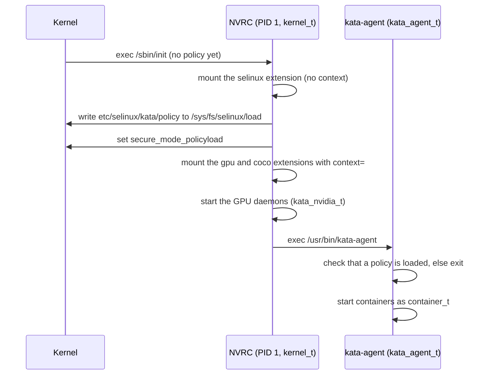

# Guest SELinux Extension

## Summary

The NVIDIA runtime-rs configurations can enforce SELinux inside the guest. The
policy ships as a [composable guest extension](composable-vm-images.md) named
`selinux`: an EROFS + dm-verity image mounted at `/run/kata-extensions/selinux`.
NVRC, the NVIDIA guest init, loads the policy before it mounts any other
extension and before it starts kata-agent. kata-agent refuses to start when the
kernel command line asks for SELinux (`selinux=1`) but no policy is loaded.

The feature is off by default. It is scoped to runtime-rs and to the NVIDIA
guest (NVRC as PID 1). The Go runtime and the systemd-based guests are not
covered.

## Motivation

Without a guest policy, every process in the guest runs unconfined: the agent,
the attestation and image-pull components, the GPU daemons, and the container
workloads. A container that escapes its namespaces reaches all of them.
Confining the workload with the same `container_t` domain the host uses, and
giving the Kata and NVIDIA components their own domains, bounds that.

Shipping the policy as an extension keeps it out of the base image. The policy
has its own measured root hash, and can be rebuilt without rebuilding the base
image.

## Design

### Boot flow



NVRC loads the policy for two reasons:

- NVRC mounts the extensions, and `context=` mount options are rejected until a
  policy is loaded. The policy therefore has to be in place before the gpu and
  coco extensions are mounted, which happens before kata-agent runs.
- The agent's domain comes from the transition `kernel_t` →
  `kata_agent_t` on exec of `kata_agent_exec_t`. The agent could not move itself
  into its domain after the fact.

NVRC fails closed. When `selinux=1` is set and the `selinux` extension is
missing, or the guest kernel has SELinux disabled, NVRC panics and the VM powers
off.

After the load, NVRC sets the `secure_mode_policyload` boolean. From then on
the policy denies further policy loads, `setenforce` and `setbool` to every
domain, NVRC included. A policy without that boolean is refused at build time,
and NVRC panics if it ever meets one: a policy that can be replaced at runtime
does not protect anything.

### Runtime configuration

The four NVIDIA runtime-rs QEMU configurations list the extension and expose
two knobs:

```toml title="configuration-qemu-nvidia-gpu-runtime-rs.toml"
[hypervisor.qemu]
disable_guest_selinux = true # (1)!

[runtime]
guest_selinux_label = "" # (2)!

[[hypervisor.qemu.guest_extension_images]]
name = "selinux"
path = "/opt/kata/share/kata-containers/kata-containers-selinux-extension.img"
verity_params = "root_hash=...,salt=...,data_blocks=...,data_block_size=4096,hash_block_size=4096"
```

1. When `false`, runtime-rs emits `selinux=1`. The NVIDIA `kernel_params`
   carry `enforcing=1`, as the guest kernel otherwise boots permissive;
   appending `enforcing=0` to them boots permissive for bring-up.
2. The label given to container processes in the guest. When empty, the host
   label's type is replaced with `container_t` and its MCS level is kept. Hosts
   without SELinux pass no label, and `system_u:system_r:container_t:s0` is
   used instead, so the workload never keeps the agent's domain.

!!! note
    The extension is attached even when guest SELinux is disabled. With
    `selinux=0` the guest kernel exposes no selinuxfs, and NVRC mounts the
    extension without loading anything.

### Domains

| Domain | Runs | Enforced |
| --- | --- | --- |
| `kernel_t` | NVRC, the syslog poller | Unconfined, as in the base policy |
| `kata_agent_t` | kata-agent, from the base image | Yes |
| `kata_nvidia_t` | Binaries run from the gpu extension | Permissive |
| `kata_coco_t` | Binaries the agent runs from the coco extension (attestation-agent, CDH, image-rs) | Permissive |
| `container_t` | Container processes | Yes |

`kata_agent_t` mirrors the host's `container_runtime_t`: it can set up
namespaces, mounts and devices, and transition into `container_t`. Unlike
`container_runtime_t`, it cannot load a policy, toggle enforcement, or change
booleans.

`container_t` can read and execute the gpu extension, because CDI injects the
driver libraries and binaries from it into GPU containers. It has no access to
the other extensions, the agent binary, or the rest of the guest.

`kata_nvidia_t` and `kata_coco_t` start out permissive so that the policy can be
tightened from real denials rather than guesses.

### Labeling

| Content | Label | Mechanism |
| --- | --- | --- |
| Base rootfs (EROFS) | From the policy's `file_contexts`, `/usr/bin/kata-agent` is `kata_agent_exec_t` | `mkfs.erofs --file-contexts` at image build |
| gpu extension | `kata_gpu_extension_t` | NVRC mount `context=` |
| coco extension | `kata_coco_extension_t` | NVRC mount `context=` |
| Other extensions | `kata_extension_t` | NVRC mount `context=`, `*` entry |
| Container rootfs, erofs snapshotter | The container's mount label, default `container_file_t` | Agent overlay `context=` |
| Container rootfs, nydus guest pull | `container_file_t` | Type transitions for content the agent and CDH create under `/run/kata-containers` |

The mount contexts come from `etc/selinux/kata/extension_contexts` in the
extension:

```text title="extension_contexts"
gpu  system_u:object_r:kata_gpu_extension_t:s0
coco system_u:object_r:kata_coco_extension_t:s0
*    system_u:object_r:kata_extension_t:s0
```

Extensions are labeled at mount time, not build time, so the coco extension
(built by guest-components) and the gpu extension need no changes.

### Policy

The policy is the Fedora targeted policy plus container-selinux, with a Kata
module (`kata-guest.cil`) on top. Starting from these reuses the upstream
`container_t` rules instead of re-deriving them.

NVRC writes the binary policy to `/sys/fs/selinux/load` as-is. It cannot
downgrade the format the way libselinux does, so the build pins the policy
version to what the guest kernel supports (35 for v6.18), through
`GUEST_SELINUX_POLICY_VERSION`.

## Build

The policy is built in a Fedora container
(`tools/packaging/static-build/guest-selinux`). Two targets consume it:

- `rootfs-image-selinux-extension` packages the policy tree as
  `kata-containers-selinux-extension.img` and emits
  `root_hash_selinux-extension.txt`. The shim-v2 build turns that into
  `SELINUXEXTENSIONVERITYPARAMS`.
- `rootfs-image-nvidia` builds the same tree and labels the base image from
  its `file_contexts`.

```bash title="$ build the extension"
make -C tools/packaging/kata-deploy/local-build rootfs-image-selinux-extension-tarball
```

!!! warning
    The base image and the extension have to come from the same policy. The
    `rootfs-image-nvidia` cache key includes the policy sources, so a policy
    change rebuilds both.

## Limitations

- `kata_nvidia_t` and `kata_coco_t` are permissive.
- Everything created under `/run/kata-containers` gets `container_file_t`, not
  only container root filesystems.
- `kata_agent_t` can still load kernel modules. NVRC disables module loading
  before it starts the agent, so this is not reachable at runtime.
- Only QEMU is wired up.
