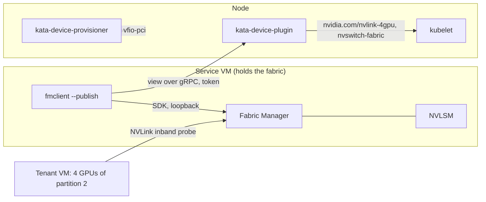

# NVIDIA HGX fabric partitions and Kata

On an HGX system the GPUs are connected through NVSwitches. In *shared NVSwitch mode* Fabric Manager (FM) runs in a Service VM that holds only the switch fabric, and it activates *partitions*: sets of GPUs that may reach each other over NVLink. A tenant VM must receive exactly one active partition's GPUs. Two tenants inside one partition would share an NVLink domain, so the partition is the isolation boundary.

This page describes the components that make a Kata cluster do this, the configurations they can run in, the day-to-day workflows, and how to read what the system says when something is off. Everything here was run on a DGX with eight GPUs and four ConnectX management PFs, Kubernetes 1.37, Kata 4.3.1 and Fabric Manager 615.

*[FM]: Fabric Manager
*[PF]: PCI physical function
*[CDI]: Container Device Interface
*[CID]: vsock context identifier

## The model

### Who owns what

Four components, four repositories, one contract between them.

kata-device-provisioner
:   Runs once per node as a Job on the trusted side. Binds the GPUs and the fabric's management functions to `vfio-pci`, writes the boot persistence for that binding, and publishes a node fact for the fabric. It changes host state; nothing else does.

kata-device-plugin
:   A DaemonSet that enumerates the node's VFIO devices and declares them to the kubelet. Read-only toward the host: it binds nothing. It also hosts the *fabric view* service that the Service VM publishes to. No Kubernetes API access.

NVRC
:   The init of the Kata guest image for NVIDIA systems. It detects what the VM received, starts Fabric Manager and NVLSM in a Service VM or the GPU driver and persistenced in a tenant VM, waits for each service to be ready, and only then starts the kata-agent.

fmclient
:   A client for Fabric Manager's SDK. Inside the Service VM it lists, activates and deactivates partitions and publishes the partition view to the plugin. On the host it does the same over vsock for the out-of-band configuration. It also owns the Service VM manifests.

The shared vocabulary lives in `pcilibs-rs`: which PCI identities are GPUs, NVSwitches or management functions, the partition view's wire format, the contract constants (environment variable names, socket path, port, the Service VM's CID), and the resolution from Fabric Manager's physical IDs to host PCI addresses.

### The fabric is one device

The plugin advertises the node's whole NVSwitch fabric as one extended resource, `nvidia.com/nvswitch-fabric`, with capacity 1 or 0. On H100 systems that is the four NVSwitch chips; on B200, B300 and Rubin systems it is the ConnectX management PFs through which NVLSM and FM manage the switches. The fabric is advertised only when every function of it is bound to `vfio-pci`; a half-bound fabric is withheld, because a Service VM with half a fabric cannot manage anything.

Its only consumer is the Service VM, which requests `nvidia.com/nvswitch-fabric: 1`. The plugin's `Allocate` for this device does one extra thing: it mints a fresh token and hands the container two environment variables, `KATA_FABRIC_VIEW_ENDPOINT` and `KATA_FABRIC_VIEW_TOKEN`. Only the fabric's holder learns where to publish and with which token.

### Partitions are resources

Fabric Manager knows the eight GPUs of this box as fifteen partitions: one of all eight, two halves, four pairs and eight singles. When an operator activates a partition, the plugin advertises it as its own extended resource, named by size:

| Active partition | Resource |
| --- | --- |
| 4 GPUs | `nvidia.com/nvlink-4gpu: 1` |
| 2 GPUs | `nvidia.com/nvlink-2gpu: 1` |
| 1 GPU | `nvidia.com/gpu: 1` |

Each unit is one device whose CDI entry carries every GPU function of the partition, in Fabric Manager's member order. A pod requesting `nvidia.com/nvlink-4gpu: 1` gets those four GPUs and no others. `nvidia.com/gpu: N` was rejected for partitions: the count cannot say whether four GPUs are NVLinked, standalone or PCIe, and only a per-shape resource lets the scheduler see how many partitions of a shape remain.

A partition is advertised only when it is active, supported by Fabric Manager, exclusive (no other active partition claims one of its GPUs) and complete (every member GPU is bound to `vfio-pci` and carries a readable slot label). Anything else is withheld and logged with the reason.

### The view channel

Fabric Manager inside the Service VM is the only authority on partitions, and it knows GPUs by *physical ID*, the module slot on the baseboard. The host knows GPUs by PCI address. Two facts bridge them:

- fmclient publishes Fabric Manager's partition list, the *view*, to the plugin over gRPC: a client stream, one message per change plus a heartbeat every 30 s. The open stream is the view's liveness. When it closes, the plugin withdraws the view after a 15 s grace period, so a Service VM restart does not flap the node's capacity and a dead Service VM does not keep its partitions advertised.
- The firmware labels every GPU function in sysfs: `/sys/bus/pci/devices/<bdf>/label` reads `GPU4, SMX3` on this DGX. The `SMX` number is Fabric Manager's physical ID; the `GPU` number is only PCI enumeration order.

The plugin listens twice: on a TCP port, 9877, exposed as a hostPort for the in-band publisher inside the Service VM, admitting only the token minted at `Allocate`; and on a unix socket, `/var/run/kata-device-plugin/fabric-view.sock`, for a publisher on the host itself, where filesystem permissions are the credential and no token is checked. One stream at a time: a newer stream supersedes the current one, and a new fabric holder withdraws the view and ends the previous holder's stream.



### Trust boundaries

Provider-owned
:   The infrastructure owns the hardware and the Service VM, in Kata and in Confidential Containers alike. The host may hold a control path into the Service VM. Both the in-band and the out-of-band configuration are admissible.

Colocation
:   The tenant owns the hardware and the Service VM and carves partitions themselves, outside the infrastructure's reach. The host must have no Fabric Manager control path. Fabric Manager's API has no read-only mode, so there is no vsock listener at all; the in-band configuration is the only one. Fabric Manager's vsock listener is therefore off unless the Service VM's own kernel command line turns it on.

The plugin never reads anything from the Service VM's filesystem or from the shim's private state: the view arrives as a protocol message or not at all.

!!! warning "Only the fabric owner may request the fabric"
    Whoever holds `nvidia.com/nvswitch-fabric` decides which GPUs share NVLink and publishes the view the node advertises, so a tenant holding it has a data path into other tenants' GPUs. The plugin cannot refuse a requester: the kubelet's Allocate carries device IDs and no pod identity. The kata-device-plugin chart ships a `ValidatingAdmissionPolicy` that denies the request outside the namespaces in its `fabricOwnerNamespaces` value (Kubernetes 1.30 or later). The runtime class whose `vsock_cid` and `kernel_params` annotations the Service VM relies on needs the same gate, since a tenant pod at CID 3 would answer the host publisher in Fabric Manager's place, and tenants hold no `pods/exec` in the owner namespace. In the colocation model the owner namespace is the tenant's own; the gate is the same.

## Configurations

A node runs in one of three deployment modes:

1. **GPU only, no fabric.** No Fabric Manager anywhere. The switches are never programmed and each GPU works alone over PCIe.
2. **GPU with the host's Fabric Manager in `FABRIC_MODE=0`.** Fabric Manager and NVLSM run on the host and program the default partition, all eight GPUs in one NVLink domain. VMs of any size share that domain; in CC mode each VM that holds more than one GPU derives its own NVLink encryption key.
3. **Service VM.** Fabric Manager runs in a Service VM in shared NVSwitch mode and activates partitions, which the node advertises as resources. The variants below, the `gpu` unit, out-of-band over vsock and the fail-closed state, all belong to this mode.

Each configuration below lists the exact commands and what the node advertises afterwards. The plugin decides by two facts it can see: whether the fabric is bound to `vfio-pci`, and whether a view is published. Modes 1 and 2 look the same to it.

| Fabric bound | View | Unit in view | Node advertises |
| --- | --- | --- | --- |
| no | none | n/a | `nvidia.com/gpu: N`, one per bound GPU (modes 1 and 2) |
| yes | none | n/a | `nvidia.com/nvswitch-fabric: 1`, no GPUs |
| yes | published | `partition` | the fabric plus one resource per active partition |
| yes | published | `gpu` | the fabric plus `nvidia.com/gpu: N`, one per GPU in an active partition |

A published view decides what the node advertises; the fabric's binding only tells the plugin whether to wait for one.

### gpu mode, no fabric

The GPUs are on `vfio-pci`, the fabric functions stay on the host's driver, and nothing programs the switches: neither Fabric Manager nor NVLSM is installed on the host. This is also what a node without NVSwitches looks like.

```bash title="$ provision the GPUs only"
kata-device-provisioner apply --mode off
```

```bash title="$ what the kubelet shows"
kubectl get node <node> -o jsonpath='{.status.capacity}' | tr ',' '\n' | grep nvidia
"nvidia.com/gpu":"8"
"nvidia.com/nvswitch-fabric":"0"
```

A pod requests `nvidia.com/gpu: 1` with `runtimeClassName: kata-qemu-nvidia-gpu` and gets one GPU. Any size up to the node's count is allocatable. Each GPU works on its own over PCIe; with no Fabric Manager anywhere the switch routing is never programmed, so the GPUs of one pod have no NVLink between them.

### gpu mode, host Fabric Manager in `FABRIC_MODE=0`

Fabric Manager and NVLSM run on the host with `FABRIC_MODE=0` in `/usr/share/nvidia/nvswitch/fabricmanager.cfg` and program the default partition: all eight GPUs in one NVLink domain. The management PFs stay on `mlx5_core` for them; only the GPUs go to `vfio-pci`. The plugin sees the same two facts as in mode 1 and advertises the same.

```bash title="$ on the host, NVLSM before Fabric Manager"
systemctl enable --now nvlsm
systemctl enable --now nvidia-fabricmanager
kata-device-provisioner apply --mode off     # --mode on for a CC node
```

```bash title="$ what the kubelet shows"
"nvidia.com/gpu":"8"
"nvidia.com/nvswitch-fabric":"0"
```

A pod requests `nvidia.com/gpu: N` for any N up to eight, and its GPUs reach each other over NVLink because every GPU sits in the one partition. All VMs on the node share that NVLink domain. In CC mode each VM that holds more than one GPU derives its own NVLink encryption key, so its traffic is unreadable to the GPUs of another VM. Shared NVSwitch mode, next, is the configuration in which the fabric itself separates tenants.

### Service VM with the view, partition unit

The fabric is bound, the Service VM holds it, fmclient publishes with `--unit=partition`. This is the shared NVSwitch mode the HGX guide describes.

```bash title="$ bind the fabric"
kata-device-provisioner apply --mode off --bind-fabric
```

The host runs no fabric service in this model. A node whose OS image ships Fabric Manager and NVLSM, as a DGX OS does, has to disable them first: they hold the management PFs on `mlx5_core`, and the provisioner refuses to take a function from a host driver.

```yaml title="deploy/service-vm.yaml (fmclient repository), the parts that matter"
runtimeClassName: kata-qemu-nvidia-gpu
nodeSelector:
  kata.feature.node.kubernetes.io/managed-fabric: "true"
containers:
  - name: fmclient
    command: ["fmclient"]
    args: ["--publish", "--unit=partition"]
    resources:
      limits:
        nvidia.com/nvswitch-fabric: 1
```

Before the Service VM publishes, the node advertises the fabric and no GPUs:

```text
"nvidia.com/gpu":"0"
"nvidia.com/nvswitch-fabric":"1"
```

After `fmclient -a 2`, `-a 6` and `-a 15` inside the Service VM, a half, a pair and a single:

```text
"nvidia.com/gpu":"1"
"nvidia.com/nvlink-2gpu":"1"
"nvidia.com/nvlink-4gpu":"1"
"nvidia.com/nvswitch-fabric":"1"
```

### Service VM with the view, gpu unit

Same deployment with `--unit=gpu`. The owner of the fabric may want eight individual GPUs out of one eight-GPU partition instead of one unit. The plugin then advertises one `nvidia.com/gpu` per GPU of an active partition, and a pod may take any number of them. NVLink between the GPUs a pod receives is still bounded by the partition they belong to; the plugin does not check that one pod's GPUs come from one partition in this unit. Use it when the node's partitions are carved so that the question does not arise, for example one partition of all GPUs.

```yaml title="the only change"
args: ["--publish", "--unit=gpu"]
```

```text
"nvidia.com/gpu":"8"
"nvidia.com/nvswitch-fabric":"1"
```

### Out-of-band over vsock

The host publishes the view and activates partitions itself, without `kubectl exec`. Three settings make it possible, all of them off by default:

- `io.katacontainers.config.hypervisor.vsock_cid: "3"` on the Service VM pod gives the VM a fixed CID. kata runtime-rs keeps 3 to 1023 for configured CIDs and draws random ones above that range; a configured CID already in use fails the sandbox.
- `io.katacontainers.config.hypervisor.kernel_params: "nvrc.fm.vsock=on"` makes NVRC write `FM_CMD_VSOCK_CID=VMADDR_CID_ANY` into Fabric Manager's configuration, so FM listens on vsock at its default port 1447971919.
- The runtime class must be the runtime-rs NVIDIA shim, `kata-qemu-nvidia-gpu-runtime-rs`, with both annotations in its `enable_annotations`.
- That shim runs without a shared filesystem and rejects an overlayfs container rootfs, so its pods need containerd's erofs snapshotter: `erofs-utils` 1.8.2 or newer on the host, and in the kata-deploy values `snapshotter.setup: ["erofs"]` plus `containerd.snapshotter: "erofs"` on the shim, as the chart's `try-kata-nvidia-gpu.values.yaml` profile sets them.

```yaml title="deploy/service-vm-out-of-band.yaml (fmclient repository), the parts that matter"
annotations:
  io.katacontainers.config.hypervisor.vsock_cid: "3"
  io.katacontainers.config.hypervisor.kernel_params: "nvrc.fm.vsock=on"
runtimeClassName: kata-qemu-nvidia-gpu-runtime-rs
containers:
  - name: fabric-holder
    command: ["sleep", "infinity"]
    resources:
      limits:
        nvidia.com/nvswitch-fabric: 1
```

```bash title="$ on the host, as root"
fmclient --vsock --publish --publish-to unix:///var/run/kata-device-plugin/fabric-view.sock
fmclient --vsock -l
fmclient --vsock -a 2
```

`--vsock` without a value is the contract address, CID 3 and FM's default port, both constants in `pcilibs-rs`. The node advertises the same resources as in the in-band configuration.

As run on the HGX B300: the shim connected to the agent at CID 3 and the pod was Running 50 s after `kubectl apply`, Fabric Manager having reached `configured` 11 s after the guest booted. `fmclient --vsock -l` on the host listed the 15 partitions, `fmclient --vsock -a 2` made the node advertise `nvidia.com/nvlink-4gpu: 1` within seconds of the publisher's next view, and a tenant VM on that unit saw the partition's four GPUs with NVLink between all of them.

!!! warning "Any host process can connect"
    A vsock connect needs no privilege on the host, so with the listener on every host process can reach Fabric Manager's API. This is the provider-owned model. Where the host must have no control path, run the in-band manifest, whose guest opens nothing.

!!! warning "One publisher per node"
    Never run the in-band and the out-of-band manifest on one node. The plugin keeps the newer stream and ends the other, so the two publishers would take turns withdrawing each other's view.

### Fail closed: fabric bound, no view

Between the provisioner binding the fabric and the Service VM publishing, and whenever the Service VM is down for longer than the grace period, the node advertises the fabric and no GPUs. The plugin logs

```text
WARN fabric is bound but no partition view is published: advertising no GPU
```

once per poll. This is the designed state: a GPU handed out without a view could land in a partition the operator did not activate.

## Workflows

### Provisioning the node

The provisioner binds every GPU and, with `--bind-fabric`, every function of the fabric. It refuses before changing anything when a function is held by a host driver, when a target has no IOMMU group, or when a target shares its IOMMU group with a function a host driver still holds.

```bash title="$ as root on the node"
systemctl disable --now nvidia-fabricmanager nvlsm   # (1)!
kata-device-provisioner status                       # (2)!
kata-device-provisioner apply --mode off --bind-fabric
```

1. Only on a node whose OS image ships them: they hold the management PFs on `mlx5_core`, and the provisioner refuses to take a function from a host driver.
2. Lists what the node would provision and the driver each function has now.

Persistence is written as `/etc/modprobe.d/kata-device-provisioner.conf` for the GPUs and address-scoped udev rules for the management functions. The node fact `kata.feature.node.kubernetes.io/managed-fabric=true` is published for Node Feature Discovery; without NFD, label the node by hand.

!!! bug "Host driver installed"
    `options vfio-pci ids=` loses the boot race against an installed host `nvidia` driver, which the kernel autoloads for the GPU's PCI identity. On a node that still has the host driver package, the GPUs come back on `nvidia` after a reboot and have to be rebound. A Kata node without the driver package is unaffected.

### Bootstrapping the Service VM

Apply the manifest. The pod schedules once the plugin advertises the fabric. Inside the guest, NVRC detects `ServiceVm(ConnectX)` on these systems, starts NVLSM and Fabric Manager back to back, waits for Fabric Manager to report its fabric configured, and starts the agent. On the DGX that took 29.5 s from boot. fmclient connects to Fabric Manager over the guest's loopback and publishes the view; the first message carries no active partitions.

```bash title="$ watch it come up"
kubectl -n kata-system get pods -w
kubectl -n kube-system logs -l app.kubernetes.io/name=kata-device-plugin | grep "fabric view"
```

```text
INFO fabric view: unit "partition", active partitions (id x gpus): none
```

### Activating and deactivating partitions

In-band, through the publishing container:

```bash title="$ the partition table and three activations"
P=$(kubectl -n kata-system get pod -l app=nvswitch-service-vm -o name)
kubectl -n kata-system exec $P -- fmclient -l
kubectl -n kata-system exec $P -- fmclient -a 2
kubectl -n kata-system exec $P -- fmclient -a 6
kubectl -n kata-system exec $P -- fmclient -a 15
kubectl -n kata-system exec $P -- fmclient -d 15
```

Within one plugin poll the node's capacity follows. The publisher logs each change:

```text
fmclient: view changed: unit "partition", active partitions (id x gpus): 2x4 6x2 15x1
```

Deactivating a partition whose unit a pod holds does not take the GPUs away from that pod; the kubelet keeps its allocation. The resource stops being advertised for new pods.

### Scheduling a tenant VM

```yaml title="a tenant on the 4-GPU partition"
apiVersion: v1
kind: Pod
metadata:
  name: tenant-nvlink4
spec:
  runtimeClassName: kata-qemu-nvidia-gpu
  containers:
    - name: smi
      image: nvcr.io/nvidia/cuda:12.6.3-base-ubuntu24.04
      command: ["nvidia-smi", "-L"]
      resources:
        limits:
          nvidia.com/nvlink-4gpu: 1
```

The kubelet allocates the unit, the plugin answers with its CDI name, and the Kata shim cold-plugs the four VFIO devices listed in the CDI entry into the VM.

!!! note "Kubernetes 1.31 or later"
    The kubelet forwards a device plugin's CDI names to the container runtime only with `DevicePluginCDIDevices`, on by default since 1.31. On an older kubelet the VM still boots with the GPUs, since the shim learns them from the PodResources API, but the container inside sees no device.

### What a tenant sees

Inside the VM, NVRC detects `Gpu { fabric: None, gpus: 4 }`, loads the driver and starts persistenced, which registers the GPUs one by one. Each registration takes about 30 s on this box and reports the UVM step as "the NVLink fabric is not ready" before "persistence mode enabled". Fabric Manager in the Service VM logs the probe requests from those GPUs "on the partition 2" and brings their access links up.

```text title="nvidia-smi -L inside the tenant"
GPU 0: NVIDIA Graphics Device (UUID: GPU-dd58ef3d-...)
GPU 1: NVIDIA Graphics Device (UUID: GPU-4fc6688b-...)
GPU 2: NVIDIA Graphics Device (UUID: GPU-12f30f43-...)
GPU 3: NVIDIA Graphics Device (UUID: GPU-18a241c9-...)
```

`nvidia-smi topo -m` shows NVLink between all four and nothing else; Fabric Manager's table shows partition 2 active with its links training.

### Service VM restart and token rotation

The token is minted at `Allocate` and persisted on the host under `/var/run/kata-device-plugin`, so a plugin restart keeps the token a Service VM already holds. A container restart inside the same pod keeps the kubelet's allocation and the environment, so the same token keeps working; the publisher reconnects and its view replaces the one that was withdrawn after the grace period.

A new Service VM pod is a new fabric holder. Its `Allocate` rotates the token: the previous holder's stream is ended at its next message, its token no longer opens a stream, and the view is withdrawn at once, since the partitions it described were the previous holder's. Until the new holder publishes, the node is in the fail-closed state.

### Plugin restart

The plugin reloads the token, re-registers both resources with the kubelet and advertises what it sees. The publisher's stream was cut by the restart; fmclient reconnects with backoff and resends the view, and the grace period covers the gap.

### Node reboot

The provisioner's persistence rebinds the fabric's management functions through its udev rules. The GPUs rebind through `vfio-pci`'s `ids=` option unless the host driver package is installed (see above). The host's `nvidia-fabricmanager.service`, if still enabled, fails its precheck because its PFs are now on `vfio-pci`; disable it. The Service VM DaemonSet recreates its pod and everything above repeats.

!!! bug "Stale Fabric Manager sessions on the GPUs"
    GPUs keep a session with the Fabric Manager that last configured them, and a VFIO reset does not clear it. After another Fabric Manager has run against the GPUs, the one a DGX OS ships on the host for example, the Service VM's Fabric Manager rejects the GPUs' inband responses with `previous session ID ... does not match the expected session ID` and lists no supported partitions. A node power cycle clears the sessions.

## Readiness and diagnostics

### NVRC markers, per switch generation

NVRC starts a service and then blocks on the one syslog line that service writes when it is ready; every marker travels from the daemon's `syslog()` call through NVRC's shim on `/dev/log` into kmsg. The marker for Fabric Manager depends on the switch generation:

| Service | Platform | Marker |
| --- | --- | --- |
| Fabric Manager | H100 and H200, direct NVSwitches | `FM starting NvLink Inband` |
| Fabric Manager | B200, B300 and Rubin, ConnectX management PFs | ``fabric manager state is `3` (configured)`` |
| nvidia-persistenced | tenant and gpu-mode VMs | `Local RPC services initialized` |

NVLSM is not waited for on its own. On these systems the subnet manager becomes master only after Fabric Manager has connected to it and synced partitions, 70 ms after FM's request on this box, so a wait for OpenSM's `Entering MASTER state` before FM starts never ends. FM configured implies NVLSM master.

### The persistenced sequence

In a tenant VM, persistenced is the gate before the agent. The guest console shows the sequence per GPU:

```text
nvidia-persistenced: device 0000:03:00.0 - registered
nvidia-persistenced: device 0000:03:00.0 - Could not Enable UVM Persistence mode because the NVLink fabric is not ready: 0x81
nvidia-persistenced: device 0000:03:00.0 - persistence mode enabled.
nvidia-persistenced: device 0000:03:00.0 - NUMA memory onlined.
```

The NVLink fabric for a tenant GPU is ready only after Fabric Manager in the Service VM has accepted the GPU's inband probe on its partition; a tenant VM started while the Service VM is restarting waits here.

### Capturing the guest console

Two settings put the guest console into the node's journal: `enable_debug = true` in the runtime's configuration (the file under `/opt/kata/share/defaults/kata-containers/runtimes/<runtime class>/`, which is the one the shim loads) and `[debug] level = "debug"` in `/etc/containerd/config.toml`, since the shim's debug lines are dropped at containerd's default level. The pod annotation `io.katacontainers.config.hypervisor.kernel_params: "nvrc.log=trace"` makes NVRC print every step.

```bash title="$ read the console of the last sandbox"
sudo journalctl --since "10 min ago" -o cat | grep -a -o 'vmconsole="[^"]*"' | sed 's/^vmconsole="//; s/"$//'
```

!!! danger "Do not restart containerd with a Kata VM holding VFIO devices"
    On this kernel the VM killed by the restart left its devices wedged: new QEMUs failed to bind them to iommufd and an unbind blocked until the retrying QEMU released the device. Stop the pods first.

### Known failure signatures

| Where | Line | Meaning |
| --- | --- | --- |
| NVRC console | `NVRC panic: ... timeout waiting for: <marker>` | the service did not reach the marker; the lines before it say what it did instead |
| FM in the Service VM | `specified partition id N is not supported` | the partition list is empty or lacks N; see the stale-session case |
| kata-deploy install job | `DEFAULT_SHIM 'qemu-runtime-rs' must be one of the configured SHIMS` | the chart's `defaultShim` names a shim the values disabled |
| kata-deploy host check | `Required host command mkfs.erofs is not available` | the values ask for the erofs snapshotter on a node without `erofs-utils` |
| containerd | `PodResources API Get method disabled` | Kubernetes before 1.31 without the `KubeletPodResourcesGet` feature gate |
| guest kernel | `cannot find valid erofs superblock` | an image built as ext4 for a runtime configured with `rootfs_type = "erofs"` |
| guest NVRC | `Module nvidia not found in directory /lib/modules/<version>` | an image whose kernel modules do not match the installed guest kernel |
| containerd | `unsupported rootfs Mount { source: "overlay", ... }` | a runtime-rs NVIDIA pod on the overlayfs snapshotter; the shim has no shared filesystem and needs the erofs snapshotter |
| kata-agent | `waiting for CDI spec(s) to be generated (N of 100 max tries) "unresolvable CDI devices nvidia.com/nic=0, ..."` | runtime-rs annotated the ConnectX functions with a CDI kind no guest image generates; the container fails after 100 s while the VM and Fabric Manager keep running. Fixed by removing the kind from the runtime's table |
| NVLSM in the Service VM | `GRPC_MGR - ... Failed to open configuration file "/usr/share/nvidia/nvlsm/grpc_mgr.conf"` | the base plus extension guest image with an NVRC that does not bind the extension's `/usr/share/nvidia` over the base path; Fabric Manager then exits with `failed to connect to the subnet manager` |
